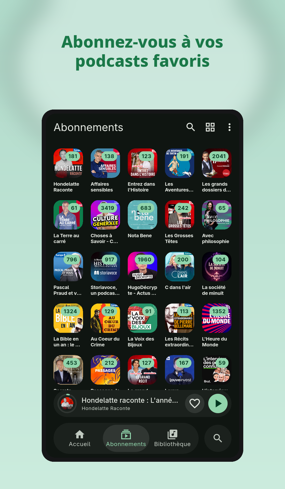
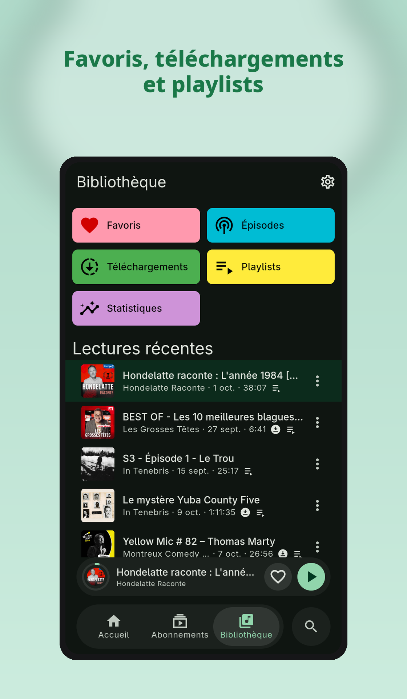

<p align="center">
  
</p>

<p align="center">
  Lecteur de podcasts libre pour Android, Windows et Linux.<br>
  On s’abonne à n’importe quel flux RSS, sans compte et sans publicité dans l’application.
</p>

<p align="center">
  <a href="https://github.com/neosis91/podavio/releases/latest"></a>
  <a href="LICENSE"></a>
</p>

<p align="center">
  <a href="https://github.com/neosis91/podavio/releases/latest"><b>Release GitHub</b></a>
  ·
  <a href="https://podavio.com/download"><b>podavio.com/download</b></a>
  ·
  <a href="https://web.podavio.com"><b>Podavio Web</b></a>
</p>

> Podavio Web ouvre la bibliothèque du téléphone dans le navigateur, après un scan du QR code.

## Fonctions

- Recherche parmi Apple Podcasts, Podcast Index et fyyd, et ajout par adresse RSS
- Import et export OPML des abonnements
- Épisodes non lus, playlist réordonnable, favoris, lectures récentes et statistiques
- Lecteur avec position mémorisée, vitesse, sauts et minuteur de sommeil
- Téléchargement des épisodes, y compris en automatique, pour les écouter hors ligne
- Chapitres, thème clair, sombre ou système, mode éco, listes confortables ou compactes
- Chromecast et Android Auto
- Podavio Web : la bibliothèque du téléphone dans le navigateur
- Vérification des mises à jour sur la dernière release GitHub

## Captures

<p align="center">
  
  
  
</p>

## Données

- Un podcast est un flux RSS. L’audio reste sur le serveur de l’éditeur. Podavio le lit, le met en mémoire ou le télécharge.
- La recherche et les suggestions interrogent Apple Podcasts, Podcast Index et fyyd.
- Les abonnements s’échangent en OPML.
- La bibliothèque, les fichiers téléchargés et la position de lecture restent sur l’appareil.

## Confidentialité

Podavio ne demande pas de compte et n’affiche pas de publicité.

La release GitHub envoie les plantages à [Sentry](https://sentry.io) pour les rattacher à une version. [Sentry](https://github.com/getsentry/sentry) est un projet libre. Cet envoi inclut l’adresse IP. Seule l’ouverture de l’application est tracée.

Un build compilé sans l’adresse Sentry n’envoie rien. C’est le cas d’un `flutter run` local, et ce sera le cas d’un build F-Droid, qui compile le dépôt sans ce secret.

## Quel fichier télécharger

La [dernière release](https://github.com/neosis91/podavio/releases/latest) contient :

- Android : `podavio-*-android-arm64-v8a.apk` pour la plupart des téléphones. `universal` si l’architecture est inconnue. `armeabi-v7a` et `x86_64` sont aussi fournis. Android 8 est le minimum.
- Windows : `podavio-*-windows-x64.msi`. L’ouvrir installe Podavio pour l’utilisateur courant et ajoute un raccourci dans le menu Démarrer. `podavio-*-windows-x64.zip` s’extrait et se lance avec `podavio.exe`, sans raccourci.
- Linux : `podavio-*-linux-amd64.deb` pour Debian, Ubuntu et les dérivés. `sudo apt install ./podavio-*-linux-amd64.deb`. L’archive `podavio-*-linux-x64.tar.gz` reste là pour une extraction manuelle. Le système fournit GTK 3, libsecret, libcurl et libmpv. Sur EndeavourOS et Arch Linux, le paquet AUR `podavio-bin` s’installe avec `yay -S podavio-bin`.

La page [podavio.com/download](https://podavio.com/download) pointe vers ces mêmes fichiers. L’application, quand elle propose une mise à jour, ouvre cette page.

macOS et iOS se compilent depuis les sources. Ils ne sont pas dans la release.

## Traduire

Les textes de l’interface sont dans `l10n/`, un fichier JSON par langue : allemand, anglais, arabe, chinois, coréen, espagnol, français, hindi, indonésien, italien, japonais, néerlandais, polonais, portugais, russe et turc. La clé est le texte anglais. Dans `l10n/en.json`, chaque valeur recopie sa clé. Les autres fichiers portent la traduction.

Pour en ajouter une, l’écrire dans le code avec `context.tr('…')`, l’ajouter dans `l10n/en.json`, puis dans les langues déjà présentes. Ensuite :

```bash
dart run tool/l10n_generate.dart
```

Le script réécrit `lib/l10n/messages.dart`. On ne modifie pas ce fichier à la main. Une traduction absente affiche l’anglais.

## Questions

**Faut-il un compte ?**
Non. Un flux RSS suffit.

**Où part l’audio ?**
Il reste chez l’éditeur du podcast. Podavio ne l’héberge pas.

**La release envoie-t-elle des données ?**
Elle envoie les plantages à Sentry, avec l’adresse IP, pour corriger l’application. Un build sans l’adresse Sentry ne le fait pas.

**Comment mettre à jour ?**
L’application compare la version installée à la dernière release GitHub. Le bouton ouvre [podavio.com/download](https://podavio.com/download).

## Contribuer

Une idée ou un défaut se signale dans les [tickets](https://github.com/neosis91/podavio/issues).

Une modification part d’une branche, ouverte vers `develop`. Cette fusion se fait en squash. La fusion de `develop` vers `main` est un commit de merge, sans squash : c’est elle qui publie la release GitHub.

## Sponsors

Sentry parraine Podavio et fournit le suivi des plantages de la release.

<p align="center">
  <a href="https://sentry.io/for/open-source/"></a>
</p>

## Licence

Podavio est un logiciel libre, sous la GNU General Public License v3.0 uniquement. Le texte est dans [LICENSE](LICENSE). Il n’y a pas de publicité, pas d’abonnement et pas de fonction payante dans l’application.

Les épisodes restent sur les serveurs de leurs éditeurs. Podavio lit le flux et le fichier. Le programme est fourni tel quel, sans garantie, comme le prévoit la licence.
